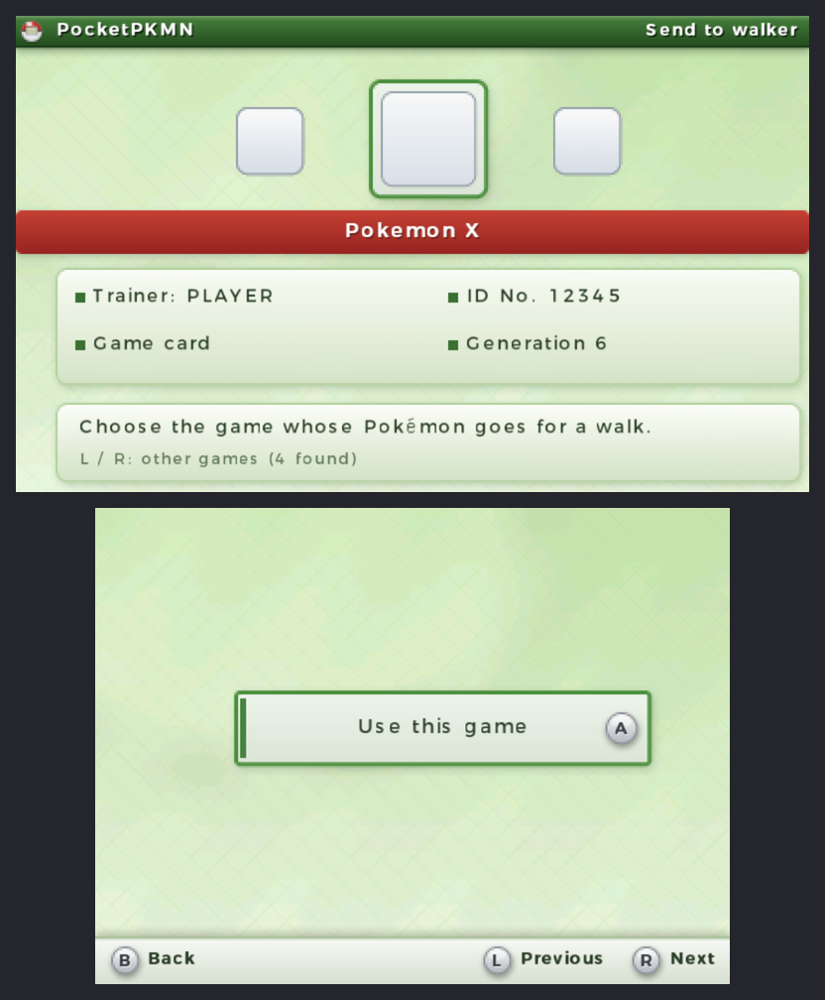
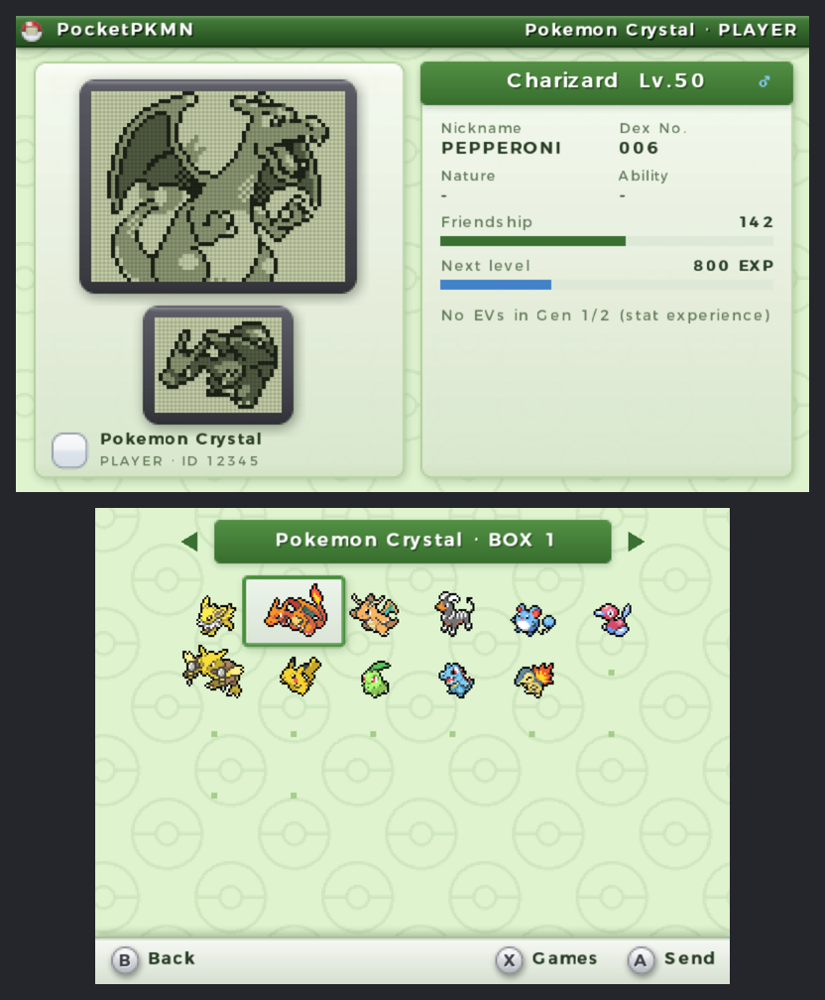
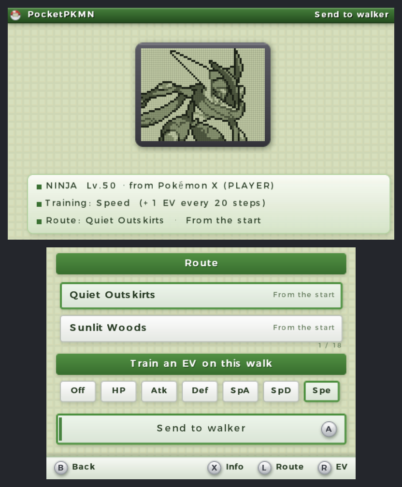

# PocketPKMN

A Pokéwalker companion app for the Nintendo 3DS (homebrew). Pick a Pokémon from a game on your 3DS, send it for a
walk on a real, unmodified **Pokéwalker** over the 3DS's infrared port, and bring it back into its game afterwards
with what the walk gave it.

 


> Fan-made and unofficial. Not made, endorsed or supported by Nintendo, The Pokémon Company, Game Freak or
> Creatures. Pokémon and Pokéwalker are trademarks of their owners. Experimental software: **back up your saves**
> (the app also makes its own backups before every change).

## About

PocketPKMN exists to be one universal piece of software for using the Pokéwalker with the Pokémon games of
generations 1 to 7, through the 3DS's own IR port.

- **Every generation in mind:** Pokémon from Gen 1–3 games get their own walker sprites (made from those games'
  sprites), so they look like themselves on the walker; later generations use walker-style sprites too.
- **Courses made per game:** each game gets its own set of courses, so walks are not the same from game to game.
- **A slightly different experience from the original:** courses open as you make progress in your game (gym
  badges, then the Hall of Fame), and the Pokémon levels on the courses rise with that progress, so what you catch
  stays useful while you play. The goal for the courses is to cover every version exclusive and trade evolution.
- **EV training on walks:** when you send a Pokémon you can pick a stat; it gains 1 EV in that stat for every 20
  steps (games with EVs).

### Current version limitations

- **Courses exist only for Gen 2 (Gold / Silver / Crystal) and Gen 6 (X / Y).** Support for the other generations is
  planned, but their courses are not designed yet. This version is an expanded proof of concept; the courses may
  still change.
- **Course unlocks are shown but not enforced yet:** every course can be picked.
- **Gen 5+ Pokémon have no second animation frame** on the walker yet (good frames for Gen 5 are being looked for).
- Saves that can be used today: see "Supported saves" below.

## Screenshots

| | |
|---|---|
|  |  |
|  |  |
|  |  |
|  |  |
|  | |

## What it does

- **Send to walker:** choose a game, a box and a Pokémon; it moves out of the game into the app's one walker slot
  and onto the Pokéwalker with a course of that game.
- **Courses per game:** Pokémon Gold / Silver / Crystal (19 courses) and Pokémon X / Y (18 courses), each with six
  Pokémon, ten items and its own picture. Games without courses yet show "Not yet compatible".
- **End walk:** reads the walker back and returns the Pokémon to its game with the walk's gains, the way
  HeartGold / SoulSilver does it (EXP = steps, at most one level; level-up friendship; +1 friendship for 5,000+
  steps), plus optional EV training (+1 EV every 20 steps in a stat you choose).
- **Walker tools:** link test, full walker backup and restore, reset, setting up a blank walker (HeartGold /
  SoulSilver menu pictures built in).
- Safety first: a full walker backup before every write, game save backups before the first change, and a detailed
  link log (`sdmc:/3ds/pocketpkmn/link_log.txt`).

Supported saves: Game Boy Virtual Console (Gen 1/2), GBA Virtual Console injects (Gen 3), Pokémon X / Y and
Omega Ruby / Alpha Sapphire (game card). Gen 4/5/7 saves are planned.

## Requirements

- A 3DS with **Luma3DS** custom firmware (tested on a New Nintendo 3DS XL). The walker link talks to the IR chip
  directly.
- A Pokéwalker.

## Install

- **CIA:** copy `pocketpkmn.cia` (from the Releases page) to the SD card and install it with FBI or
  Universal-Updater; start PocketPKMN from the HOME Menu.
- **3dsx:** copy `pocketpkmn.3dsx` to `sdmc:/3ds/` and start it from the Homebrew Launcher.

The app keeps its data in `sdmc:/3ds/pocketpkmn/` (trainer, ledger, slot, backups, settings). Versions before the
rename used `sdmc:/3ds/walkerbox/`; the first start moves that folder.

## Build

devkitARM (devkitPro) with libctru, citro2d and citro3d. On Windows the included `build.ps1` builds inside the
`devkitpro/devkitarm` Docker image in WSL:

```
.\build.ps1        # pocketpkmn.3dsx
.\build.ps1 cia    # also pocketpkmn.cia (needs makerom + bannertool, see cia/make_cia.sh)
```

Elsewhere: `make` (and `make cia`). `make` does not notice changes in `romfs/` - delete the .3dsx first.

PC tests (Linux / WSL, gcc): `tests/run.sh`, `run_routes.sh`, `run_sprite_gen.sh` and `run_migrate.sh` run anywhere.
`run_storage.sh`, `run_walk.sh`, `run_image.sh` and `run_sprites.sh` read real game saves and walker backups (a
`hw/` folder) that are not part of this repository; without it they print "skipped" and pass.

Tools for the art and data are in `tools/` (Python 3 + Pillow): `ui_atlas.py` (UI pieces), `route_art.py` (course
pictures), `routes_gsc.py` / `routes_xy.py` (course files from the course workbooks), `make_icons.py` (box icons),
`cia_art.py` (banner, icon, jingle).

## Credits

See [docs/CREDITS.md](docs/CREDITS.md) (also in the app: Settings → Credits): PKSM-Core, devkitPro, the Smogon
Sprite Project and its spriters, PokeSprite, the Pokéwalker 3D model by Callum Lax (CC BY 4.0), the "Nintendo 3DS"
3D model by Derek, and more.

## Licence

GNU General Public License v3.0 - see [LICENSE](LICENSE). PocketPKMN uses PKSM-Core (GPL-3.0). Third-party parts
keep their own licences (see the credits). Pokémon graphics are © Nintendo / Creatures Inc. / GAME FREAK inc.
