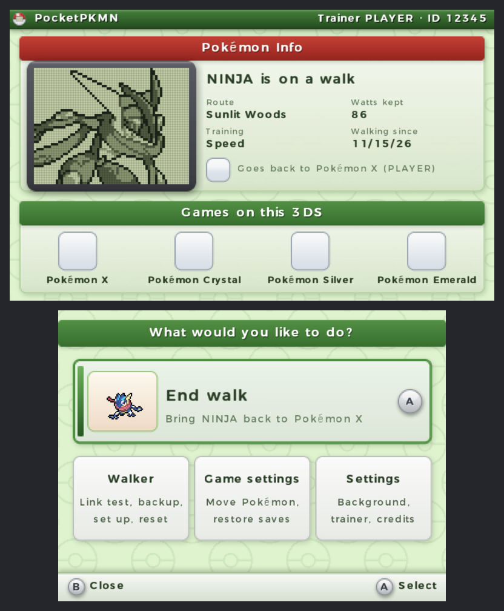
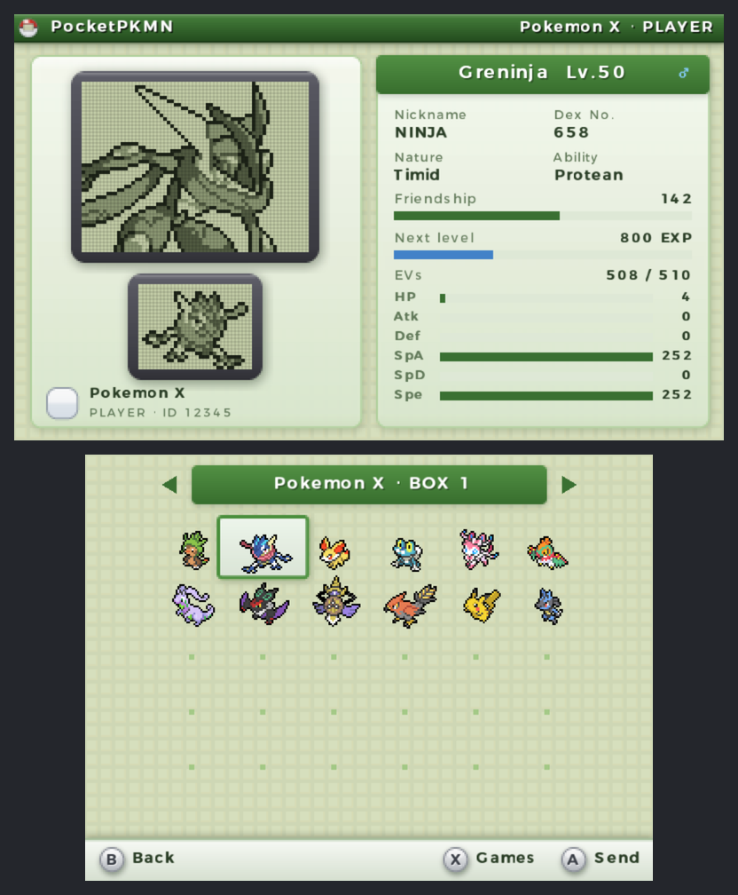
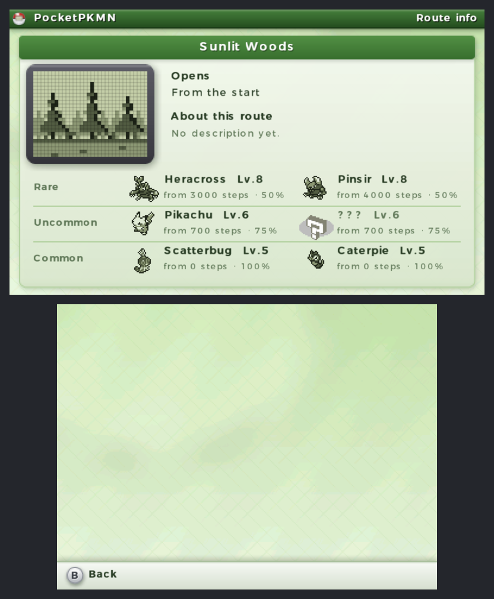
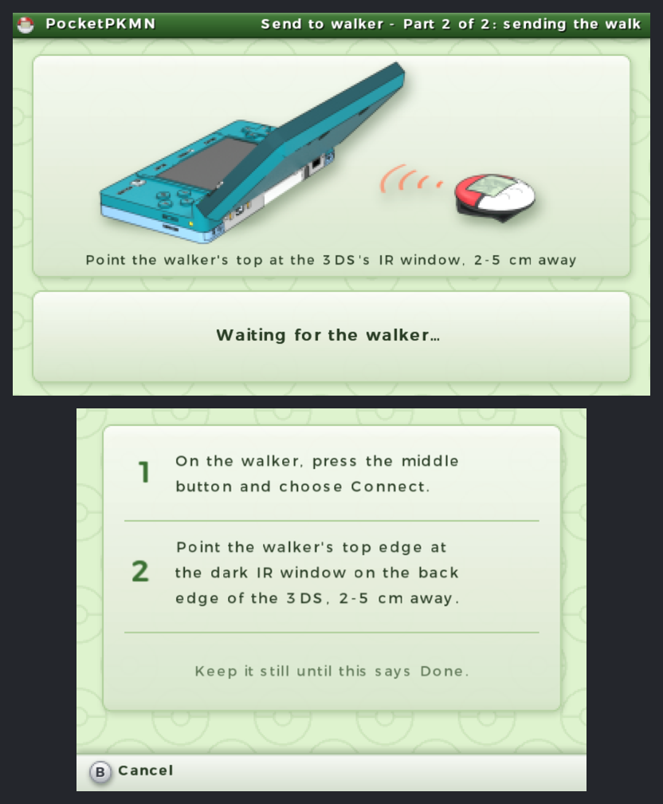
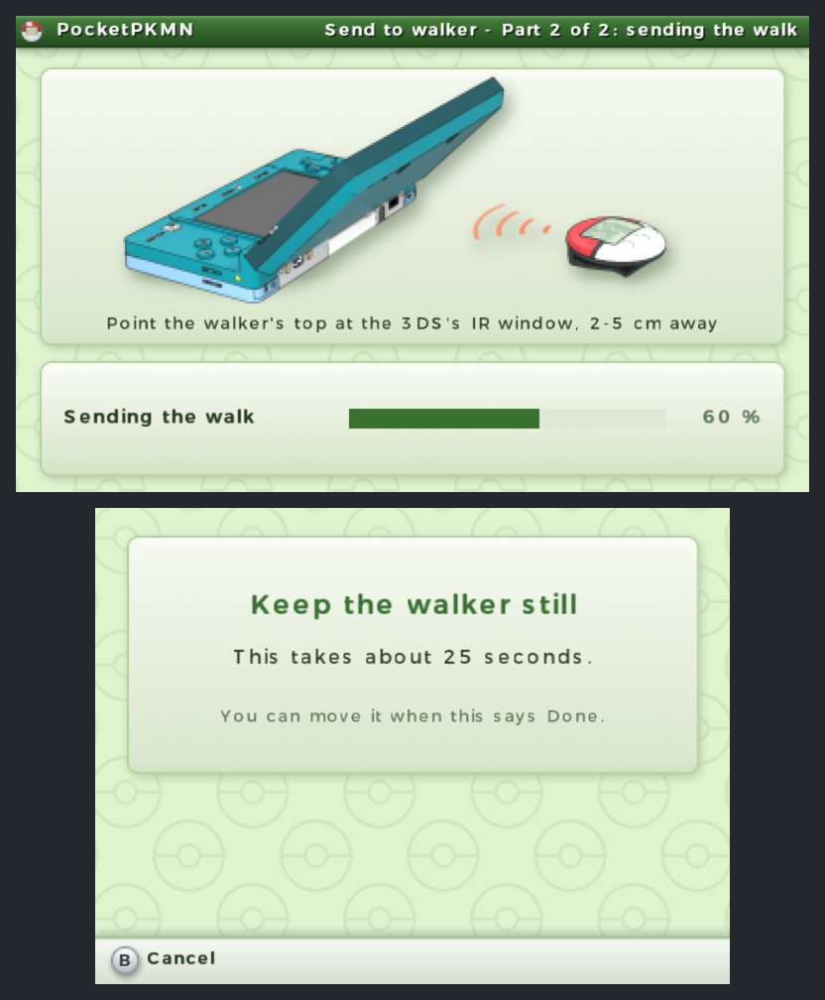
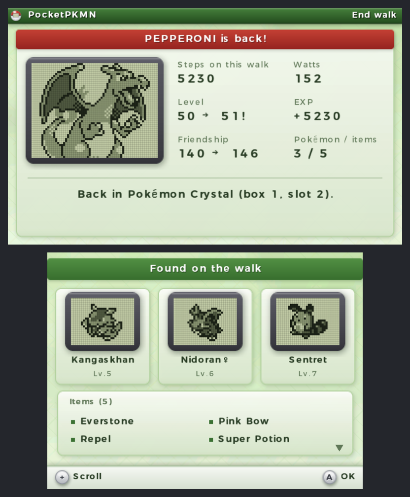

# PocketPKMN

A Pokéwalker companion app for the Nintendo 3DS (homebrew). Pick a Pokémon from a game on your 3DS, send it for a
walk on a real, unmodified **Pokéwalker** over the 3DS's infrared port, and bring it back into its game afterwards
with what the walk gave it.

 


> Fan-made and unofficial. Not made, endorsed or supported by Nintendo, The Pokémon Company, Game Freak or
> Creatures. Pokémon and Pokéwalker are trademarks of their owners. Experimental software: **back up your saves**
> (the app also makes its own backups before every change).

## About

PocketPKMN exists to be one universal piece of software for using the Pokéwalker with the Pokémon games of
generations 1 to 7, through the 3DS's own IR port.

- **Every generation in mind:** Pokémon from Gen 1/2 games get their own walker sprites (made from Pokémon
  Crystal's sprites), so they look like themselves on the walker; every other Pokémon up to Gen 7 has a walker-style
  sprite too, with two animation frames up to Gen 5. (A Gen 3 set is planned.)
- **Courses made per game:** each game gets its own set of courses, so walks are not the same from game to game.
- **A slightly different experience from the original:** courses open as you make progress in your game (gym
  badges, the Hall of Fame, and for some later courses collected watts), and the Pokémon levels on the courses rise
  with that progress, so what you catch stays useful while you play. The goal for the courses is to cover every
  version exclusive and trade evolution.
- **Legal catches:** Pokémon caught on a walk go into the walked Pokémon's game as legal Pokémon of that game, with
  your trainer's details - made from origins found and checked with PKHeX's own legality analysis (hidden abilities
  wherever a legal origin allows one). Found items go to the game's PC item storage (Gen 2) or bag (Gen 4, X / Y
  and Gen 7, which have no item PC).
- **EV training on walks:** when you send a Pokémon you can pick a stat; it gains 1 EV in that stat for every 20
  steps (games with EVs).

### Current version limitations

- **Courses exist for Gen 2 (Gold / Silver / Crystal), Gen 4 (Diamond / Pearl / Platinum), Gen 6 (X / Y) and Gen 7
  (Sun / Moon / Ultra Sun / Ultra Moon).** Support for the other games is planned (HeartGold / SoulSilver get courses
  of their own later). This version is an expanded proof of concept; the courses may still change.
- **Gen 4** has been tested on one console with Pokémon Diamond (a box move and a full walk) and Pokémon Platinum
  (a box move both ways) game cards; saves of TWiLight Menu++ (`.sav` on the SD card) are checked on PC only.
- **Gen 7** has been tested on one console with Pokémon Moon (game card) and Pokémon Ultra Sun (a full walk: out of
  the game and back in, and the game loads it). Before v0.81, Ultra Sun / Ultra Moon refused every change ("its
  safety check refused"); that is fixed. Keep your save backups.
- **Gen 6 / 7 Pokémon have no second animation frame** on the walker yet.
- Saves that can be used today: see "Supported saves" below.

## Screenshots

| | |
|---|---|
|  |  |
|  |  |
|  |  |
|  |  |
|  | |

## What it does

- **Send to walker:** choose a game, a box and a Pokémon; it moves out of the game into the app's one walker slot
  and onto the Pokéwalker with a course of that game.
- **Courses per game:** Pokémon Gold / Silver / Crystal (19 courses), Pokémon Diamond / Pearl / Platinum (17
  courses), Pokémon X / Y (18 courses) and Pokémon Sun / Moon / Ultra Sun / Ultra Moon (18 courses, opening with the
  island trials), each with six Pokémon, ten items and its own picture. Games without courses yet show "Not yet
  compatible".
- **Sound:** button clicks and transfer sounds, and background music: "Pocket Stroll", PocketPKMN's own song
  (composed for the app; every sound is synthesised by `tools/compose_song2.py`, no samples). To hear your own
  music instead, put a `music.bin` (made with `tools/make_music.py`, see `tools/find_loop.py` for the loop) in
  `sdmc:/3ds/pocketpkmn/`; it is used first. Sound needs the console's DSP firmware (`sdmc:/3ds/dspfirm.cdc`).
- **End walk:** reads the walker back and returns the Pokémon to its game with the walk's gains, the way
  HeartGold / SoulSilver does it (EXP = steps, at most one level; level-up friendship; +1 friendship for 5,000+
  steps), plus optional EV training (+1 EV every 20 steps in a stat you choose).
- **Walker tools:** link test, full walker backup and restore, reset, setting up a blank walker (HeartGold /
  SoulSilver menu pictures built in).
- Safety first: a full walker backup before every write, game save backups before the first change, a game save
  changed only the way the game itself changes it, a walk's results kept on the SD card until every one of them has
  reached its game (nothing is lost or doubled if the power goes), and a detailed link log
  (`sdmc:/3ds/pocketpkmn/link_log.txt`).

Supported saves: Game Boy Virtual Console (Gen 1/2), GBA Virtual Console injects (Gen 3), Pokémon Diamond / Pearl /
Platinum (DS game card in the 3DS, or a TWiLight Menu++ `.sav` on the SD card), Pokémon X / Y, Omega Ruby / Alpha
Sapphire, Sun / Moon and Ultra Sun / Ultra Moon (game card or download). HeartGold / SoulSilver and Gen 5 saves are
planned.

## Requirements

- A 3DS with **Luma3DS** custom firmware (tested on a New Nintendo 3DS XL). The walker link talks to the IR chip
  directly.
- A Pokéwalker.

## Install

- **CIA:** copy `pocketpkmn.cia` (from the Releases page) to the SD card and install it with FBI or
  Universal-Updater; start PocketPKMN from the HOME Menu.
- **3dsx:** copy `pocketpkmn.3dsx` to `sdmc:/3ds/` and start it from the Homebrew Launcher.

The app keeps its data in `sdmc:/3ds/pocketpkmn/` (trainer, ledger, slot, backups, settings). Versions before the
rename used `sdmc:/3ds/walkerbox/`; the first start moves that folder.

## Build

Full details (tool versions, the WSL distribution `build.ps1` expects): [docs/BUILDING.md](docs/BUILDING.md).
devkitARM (devkitPro) with libctru, citro2d and citro3d. On Windows the included `build.ps1` builds inside the
`devkitpro/devkitarm` Docker image in WSL:

```
.\build.ps1        # pocketpkmn.3dsx
.\build.ps1 cia    # also pocketpkmn.cia (needs makerom + bannertool, see docs/BUILDING.md)
```

Elsewhere: `make` (and `make cia`). `make` does not notice changes in `romfs/` - delete the .3dsx first.

PC tests (Linux / WSL, gcc): `tests/run.sh`, `run_routes.sh`, `run_sprite_gen.sh` and `run_migrate.sh` run anywhere.
`tests/run_catches.sh` builds every possible walk catch and runs PKHeX.Core's legality analysis on it (needs .NET 10
and the checker in `tools/pkhex_check_*.cs`, built as `~/pkhex-check`); `tools/pkhex_check_Templates.cs` makes the
legal catch templates in `romfs/routes/catch_*.bin` (reports: `docs/CATCHES_XY.md`, `docs/CATCHES_GSC.md`).
`run_storage.sh`, `run_walk.sh`, `run_image.sh`, `run_sprites.sh`, `run_restore.sh` and `run_catches.sh` read real
game saves and walker backups (a `hw/` folder) that are not part of this repository; without it they print
"skipped" and pass. `run_pending.sh` stops a walk's delivery at every step and checks that nothing is ever
delivered twice.

Tools for the art and data are in `tools/` (Python 3 + Pillow): `ui_atlas.py` (UI pieces), `route_art.py` (course
pictures), `routes_gsc.py` / `routes_xy.py` (course files from the course workbooks), `make_icons.py` (box icons),
`cia_art.py` (banner, icon, jingle).

## Credits

See [docs/CREDITS.md](docs/CREDITS.md) (also in the app: Settings → Credits): PKSM-Core, devkitPro, the Smogon
Sprite Project and its spriters, PokeSprite, the Pokéwalker 3D model by Callum Lax (CC BY 4.0), the "Nintendo 3DS"
3D model by Derek, and more.

## Licence

GNU General Public License v3.0 - see [LICENSE](LICENSE). PocketPKMN uses PKSM-Core (GPL-3.0), with one small local
change to its Gen 7 save signing (noted in `lib/PKSM-Core/UPSTREAM_COMMIT.txt`). Third-party parts
keep their own licences (see the credits). Pokémon graphics are © Nintendo / Creatures Inc. / GAME FREAK inc.
