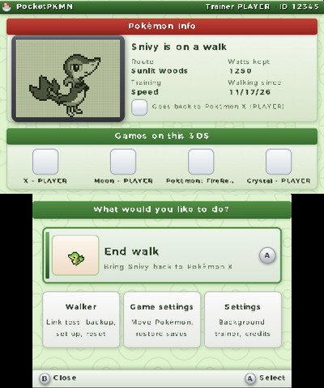

# PocketPKMN

A Pokéwalker companion app for the Nintendo 3DS (homebrew). Send a Pokémon from a game on your 3DS for a walk on a
real, unmodified **Pokéwalker** over the 3DS's own infrared port, then bring it back into its game with what the walk
gave it — plus the Pokémon and items it found.

> Fan-made and unofficial. Not made, endorsed or supported by Nintendo, The Pokémon Company, Game Freak or
> Creatures. Pokémon and Pokéwalker are trademarks of their owners. Experimental software: **back up your saves**
> (the app also backs up a game save before changing it).

## Supported games

| Game | Read / move Pokémon | Walks + courses | Catches | Items go to | Tested on a console |
|---|:---:|:---:|:---:|---|---|
| Red / Blue / Yellow (Virtual Console) | ✅ | — | — | — | moves (Blue) |
| Gold / Silver / Crystal (Virtual Console) | ✅ | ✅ 19 courses | ✅ | PC | full walks (Crystal) |
| FireRed / LeafGreen (GBA Virtual Console inject) | ✅ | ✅ 20 courses | ✅ | PC | walks (FireRed) |
| Ruby / Sapphire / Emerald (GBA inject) | ✅ | ✅ 29 courses | ✅ | PC | moves (Emerald) |
| Diamond / Pearl / Platinum (DS card or TWiLight Menu++ `.sav`) | ✅ | ✅ 17 courses | ✅ | bag | full walks (cards) |
| HeartGold / SoulSilver | read only | — | — | — | — |
| X / Y | ✅ | ✅ 18 courses | ✅ | bag | full walks |
| Omega Ruby / Alpha Sapphire | ✅ | ✅ 18 courses | ✅ | bag | one walk (Alpha Sapphire) |
| Sun / Moon / Ultra Sun / Ultra Moon | ✅ | ✅ 18 courses | ✅ | bag | full walks |

Gen 5 (Black / White) is not supported yet. Games without courses show "Not yet compatible" when sending.

## What it does

- **Send to walker / End walk:** pick a game, a box and a Pokémon; it goes onto the Pokéwalker with one of that
  game's courses and comes back with the walk's EXP (at most one level), friendship and, if you turned it on, **EV
  training** in one stat.
- **Courses for each game:** six Pokémon and ten items each, opening as you progress in that game (badges or island
  trials, the Hall of Fame, total watts). The courses aim to cover each game's version exclusives.
- **Legal catches:** every Pokémon a walk can catch is checked with PKHeX's legality analysis for each game it can go
  into (Hidden Abilities wherever a legal origin allows one), and gets your trainer details.
- **Walker sprites that fit the game:** Pokémon from Gen 1/2 and Gen 3 games show their own generation's sprites;
  Gen 5–7 games show forms (Alolan forms, Vivillon patterns, Silvally types, …) and the female Pyroar.
- **Safety first:** a game save is changed only the way the game itself changes it, and is read again right before
  every write (a swapped card is refused); a walk's results stay on the SD card until each one has reached its game;
  full walker backups; a detailed log in `sdmc:/3ds/pocketpkmn/link_log.txt`.
- **Walker tools:** link test, walker backup / restore / reset, setting up a blank walker.

## Requirements and install

- A 3DS with **Luma3DS** custom firmware (tested on a New Nintendo 3DS XL) and a Pokéwalker.
- **CIA:** install `pocketpkmn.cia` from the Releases page with FBI or Universal-Updater. **3dsx:** copy
  `pocketpkmn.3dsx` to `sdmc:/3ds/` and start it from the Homebrew Launcher.
- Sound needs the console's DSP firmware (`sdmc:/3ds/dspfirm.cdc`). The app keeps its data in `sdmc:/3ds/pocketpkmn/`.

## Build

devkitARM (devkitPro) with libctru, citro2d and citro3d; on Windows `.\build.ps1` (and `.\build.ps1 cia`) builds in
the `devkitpro/devkitarm` Docker image in WSL. Details: [docs/BUILDING.md](docs/BUILDING.md). PC tests are in
`tests/` (`run_catches.sh` checks every possible catch with PKHeX.Core; tests that need real saves print "skipped"
without them).

## Credits and licence

See [docs/CREDITS.md](docs/CREDITS.md) (also in the app: Settings → Credits): PKSM-Core, devkitPro, the Smogon
Sprite Project and its spriters, PokeSprite, the Pokéwalker 3D model by Callum Lax (CC BY 4.0), and more.

GNU General Public License v3.0 — see [LICENSE](LICENSE). Uses PKSM-Core (GPL-3.0) with one small local change
(`lib/PKSM-Core/UPSTREAM_COMMIT.txt`). Pokémon graphics are © Nintendo / Creatures Inc. / GAME FREAK inc.
